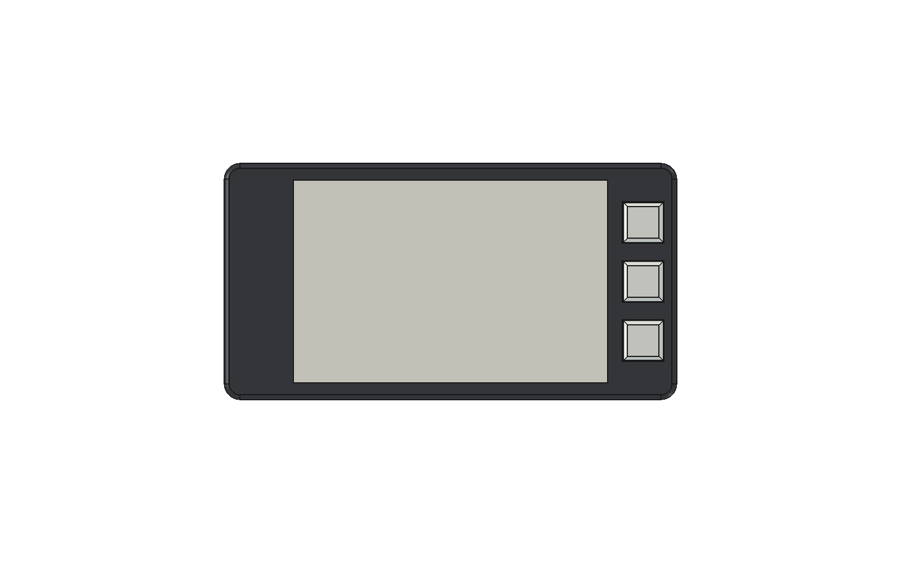

# Landscape handheld (3.52" e-paper)

A pocketable flashcard device: 3.52" 360×240 e-paper in landscape, three buttons
stacked right of the screen, equal grips on both sides, LiPo charged over USB-C.
Built to be ordered fully assembled from JLCPCB (Economic PCBA, single-sided,
nothing to solder yourself). The buttons are rubber keys pressing on bare PCB
contacts; see [Rubber keys](#rubber-keys-what-to-order).

| | |
|---|---|
| Case (rough) | 115 × 60 × 12 mm, 15 mm grip each side of the screen |
| PCB | 98 × 56 mm, 2 layers (≤ 100×100 keeps JLC's lowest PCB price) |
| MCU | ESP32-C3-WROOM-02-N4 (4 MB flash, USB, BLE) |
| Power | USB-C → TP4054 (~200 mA) → 403450 LiPo (JST-PH 2.0) → RT9080 3.3 V LDO (2 µA Iq) |
| Buttons | 3 bare-copper contacts (9 mm interleaved combs, 15 mm pitch) on the front + rubber keys in the case |

- `pcb/`: tscircuit project (`npx tsci build`, `npx tsci export flashcard.circuit.tsx -f gerbers -o fab/gerbers.zip`).
  `pcb/fab/gerbers.zip` contains gerbers, drills, `bom.csv` and `pick_and_place.csv`.
- `case/`: FreeCAD form-factor study (`case.FCStd`, `case.step`, renders). No snap fits or screws yet.

## Ordering at JLCPCB
1. Upload `pcb/fab/gerbers.zip` (2 layers, 1.6 mm, green). Prefer the **ENIG** surface finish: the key contacts are exposed copper and gold doesn't oxidize. HASL works too, but contact resistance creeps up over time.
2. Enable PCB Assembly, choose **Economic** and **top side** (all parts are on the back = top layer; the front only has the bare key contacts).
3. Upload `bom.csv` and `pick_and_place.csv` from the zip.
4. In the placement preview, check the rotations of **USB1** and **U3**: the export couldn't verify their pin-1 orientation.

History: with through-hole switches on the front, JLC answered "your configuration does not support Economic" (Economic only assembles one side, through-hole included). That's why the buttons are now bare contacts.

### Expected cost (5 boards, prices from 2026-11-21)
| Item | |
|---|---|
| Parts | ≈ $4.28 per board → $21.40 |
| Economic setup + stencil | $8.18 + $1.53 |
| Extended-part fee: 8 types × $3.07 | $24.56 |
| SMT joints (~230 × 5 × $0.0016) | ≈ $1.84 |
| PCB (5 pcs, ≤ 100×100; ENIG extra) | ≈ $2 + ENIG |
| **Total before shipping** | **≈ $60 + ENIG** |
| Rubber keys (separate, see below) | ≈ $5 |

The 8 extended parts are U1 C2934560, USB1 C2765186, U2 C668215, U3 C841192, J3 C2856831,
L2 C135265, Q5 C52895 and J2 C3029440. Everything else is a basic part, which has no fee in Economic PCBA.
R32 + R34 (2 Ω + 1 Ω, both basic) replace the reference circuit's single 3 Ω
sense resistor, which is extended.

## ESP32-C3 pin map
| GPIO | Use |
|---|---|
| IO0 | BAT_ADC (VBAT / 2) |
| IO1 | EPD_BUSY |
| IO2 | EPD_PWR_EN (low = panel on; R30 pull-up = strapping high) |
| IO3 / IO4 / IO5 | BTN1 / BTN2 / BTN3 (top to bottom), active low, internal pull-ups; deep-sleep wake (only GPIO0–5 can). Rubber contacts bounce longer: debounce ~20–30 ms |
| IO6 / IO7 | EPD_SCLK / EPD_SDI |
| IO8 | EPD_CS (R33 pull-up, strapping) |
| IO9 | BOOT pad on J5 (USB enters download mode without it) |
| IO10 | EPD_DC |
| IO18 / IO19 | USB D− / D+ |
| IO20 (RXD) | EPD_RST |
| IO21 (TXD) | TX pad on J5 |

**Firmware:** `devboard-waveshare-1-54/esp` targets the ESP32-S3 dev board (touch, SD card).
This board needs a port: buttons instead of touch, internal flash instead of SD, 360×240 panel, C3 pins.

## Rubber keys: what to order
Each key needs a conductive underside (carbon pill or conductive ring) that bridges
the two combs of a 9 mm contact (`pcb/lib/ContactPad.tsx`). Contact resistance of
20–100 Ω is far below the ~45 kΩ internal pull-up.

| Option | What | Price | Fit / notes |
|---|---|---|---|
| **1 (recommended)** | [Adafruit 1611 Silicone Elastomer 4×4 Button Keypad](https://www.adafruit.com/product/1611) (also sold by EU resellers such as [Pimoroni](https://shop.pimoroni.com/en-ch/products/adafruit-silicone-elastomer-4x4-button-keypad-for-3mm-leds)) | $4.95 | Keys 10×10 mm, 10 mm tall, 15 mm pitch, ~3 mm travel, conductive ring underneath. **Cut a 1×3 column** and it drops onto the 15 mm-pitch contacts; one pad gives 4 strips. Footprint reference: `ELAST_PAD_SQUARE_10MM_5.4MM_4X4GRID` in [Adafruit_Trellis.lbr](https://github.com/adafruit/Adafruit_Trellis). |
| 2 | [SparkFun Button Pad 2×2 – LED Compatible (COM-07836)](https://www.sparkfun.com/products/7836) | ~$2.25 | Bigger keys with a conductive circle underneath; often on backorder. Check the [dimensional drawing](https://cdn.sparkfun.com/assets/5/3/0/a/d/4x4_button_pad.pdf) before using it: the pitch differs, so it would need a case adapter or new contact positions. |
| 3 | Generic single silicone keys with carbon pill (eBay/AliExpress, e.g. "Φ12×Φ7×H6mm conductive silicone keypad", ["round silicone rubber single key conductive carbon"](https://www.ebay.com/itm/265924528040)) | ~$2–5 per bag | Cheapest, round, molded snap feel. Sizes vary per listing: measure one, then I adapt the bezel. A 7 mm pill covers most of the 9 mm contact. |
| 4 | Conductive rubber pad assortment (remote-control repair kits: 100 pcs, 1.5–10 mm Ø, ~0.5 mm thick, usually without adhesive) + **TPU-printed keys** | ~$5 | Any key shape you like. Glue the pill under a printed key with flexible glue. Softer feel without a snap. TPU 95A webs ≥ 0.8 mm. |
| 5 | Cast your own: platinum-cure silicone in a printed mold + pills from option 4 | ~$20–30 | Most control, most work. Only worth it once the shape is settled. |

**Plan:** order option 1 (plus option 4 as a backup and for experiments). With a key in hand,
model the bezel's clamping frame so that the web sits flat on the PCB and the pill or ring rests
0.8–1.2 mm above the contacts.

Case TODO: the Adafruit keys are 10 mm tall from the web. With the current 12 mm case they
stand ~6 mm proud of the bezel. Either thicken the right grip, trim the key tops, or
countersink them; decide once the keypad is here.
